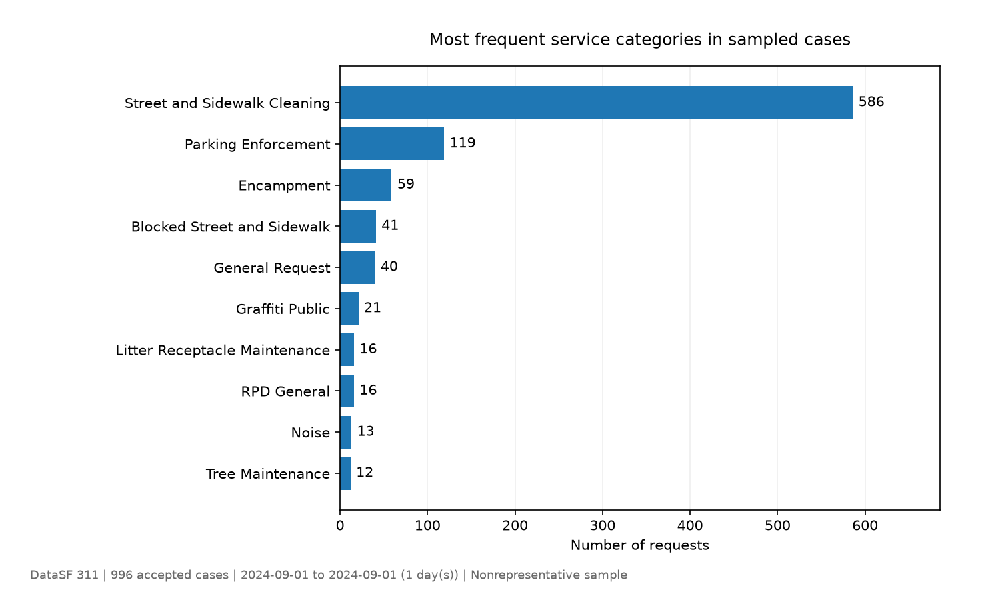
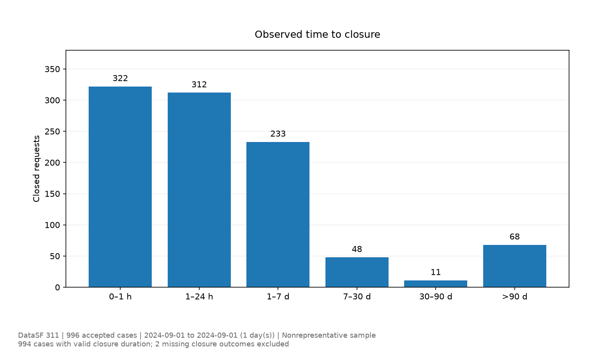
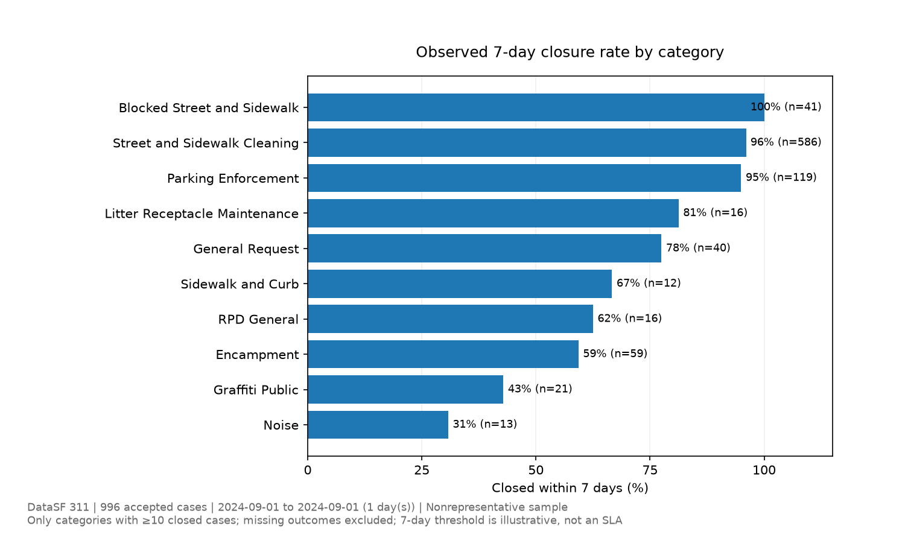

# Open Data Intelligence Pipeline

[](https://github.com/sahmadi-1/open-data-intelligence-pipeline/actions/workflows/ci.yml)

A small, reproducible **Python, pandas, SQLite and Matplotlib data-quality and reporting project**, created as a public engineering portfolio demonstration.

> The default demonstration uses **synthetic municipal service requests**. An optional, explicitly invoked real-data path uses selected public DataSF 311 records; CI never makes network calls. No proprietary source code, patient records, or trading information are used.

## What it demonstrates

- Deterministic synthetic CSV generation containing deliberate data defects
- Validation, data cleaning, duplicate handling and explicit quality counts
- Idempotent SQLite upserts and SQL aggregation
- Reproducible JSON reporting and a simple command-line interface
- Offline PNG charts using Matplotlib (sample volumes, closure durations and illustrative seven-day closure rates)
- Automated tests using pytest and GitHub Actions

## Data visualizations — real-world 311 sample

These PNG charts were generated with **pandas and Matplotlib** from a bounded, chronological extract of [San Francisco 311 Cases](https://data.sf.gov/d/vw6y-z8j6).

**Sample:** 1,000 source rows (996 accepted after validation), retrieved on 2026-11-15. All requests in this extract were opened on **September 1, 2024, between 00:00 and 14:15**; it does *not* cover the full month or represent citywide performance. Two accepted cases have no observed closure date.

### 1. Service request volume



### 2. Closure-time distribution



### 3. Seven-day closure rate by category



**Interpretation:** Descriptive exploratory analysis only. Rates exclude missing closure outcomes, category sample sizes vary, and the seven-day threshold is illustrative — **not an official service-level agreement**. These results must not be generalized to the city's population of service requests. Additional charts are generated locally into the ignored `output/` directory.

## Run locally

Requires Python 3.11+.

```bash
python -m venv .venv
# Activate the venv, then:
python -m pip install -e '.[dev]'
python -m open_data_intelligence demo
python -m open_data_intelligence run
python -m pytest -q
```

On Windows PowerShell with Python 3.12:

```powershell
py -3.12 -m venv .venv
.\.venv\Scripts\python.exe -m pip install -e '.[dev]'
.\.venv\Scripts\python.exe -m open_data_intelligence demo
.\.venv\Scripts\python.exe -m open_data_intelligence run
.\.venv\Scripts\python.exe -m pytest -q
```

Outputs, generated locally and excluded from Git:

- `data/demo.csv`: synthetic input dataset
- `output/services.sqlite`: validated stored records
- `output/report.json`: quality and district-summary report

The default demonstration produces **85 input rows**, including **1 duplicate** and **4 invalid rows**, leaving **80 validated rows**. Re-running the input does not add duplicates to SQLite.

## Project layout

- `src/open_data_intelligence/`: deterministic dataset generator, cleaning, SQLite and CLI
- `tests/`: data quality and idempotence tests
- `.github/workflows/ci.yml`: automated tests on pushes and pull requests

## Scope and limitations

This is a deliberate minimum viable engineering demonstration, **not a production service**. It has no cloud infrastructure, deployed ML model or web UI. Validation rules target the described synthetic schema. Potential future improvements include a properly licensed external dataset and an explicitly evaluated forecasting baseline.

## Confidentiality

All code and demo records in this repository were created separately for this portfolio project and do not contain employer-owned code, customer details, or private datasets.


## Optional real-world data path (v0.2)

**Source:** [San Francisco 311 Cases](https://data.sf.gov/d/vw6y-z8j6) (dataset `vw6y-z8j6`)  
**Publisher:** San Francisco 311 / DataSF  
**License:** [ODC PDDL 1.0](https://opendatacommons.org/licenses/pddl/1-0/) (public domain)  
**Access:** Socrata SODA2 public CSV query. The live request has not yet been executed in this repository environment.

This is an independent optional workflow; it does not replace the synthetic demo.

~~~bash
# Explicit external API call (only when you run this command):
python -m open_data_intelligence.sf311 fetch --start 2024-09-01 --end 2024-10-01 --limit 5000

# Offline cleansing, idempotent SQLite load and JSON reporting:
python -m open_data_intelligence.sf311 analyze
~~~

- Requests only six structured fields: case ID, request date, closure date, category, subtype and supervisor district. **Does not request addresses, free-text details, notes, names or precise coordinates.**
- The download is bounded to at most 10,000 records / 12 MB, and defaults to a fixed historical date window for repeatability.
- Reports duplicate IDs, invalid or missing dates, negative durations, long-duration outliers and missing closure outcomes.
- Keeps records without closure outcomes but excludes them from observed resolution-time calculations.
- Reports a seven-day closure threshold as an **illustrative descriptive metric**, not an official agency service-level agreement.
- The slice is the *first* rows in date order within the requested window, **not a representative random sample**. Do not generalize its rates to the full population.
- Generated CSV, SQLite and JSON files are not committed. Data may change upstream between fetches. A Windows-based manual run on 2026-11-15 successfully fetched 1,000 historical requests (996 accepted), but covered **only 2024-09-01**, not a full month. Its rates are **not representative** of the city or a sufficiently broad timeframe for ML evaluation.
- This version does **not** train or claim a predictive ML model. Any future prediction must use only information available at request creation, with time-based validation and careful handling of censored/unresolved requests.

## Offline Matplotlib charts (v0.2.1)

Once you have already fetched the optional SF311 CSV, install the visualization extra and generate PNGs **without any new network request**:

```powershell
$python = ".\.venv\Scripts\python.exe"
& $python -m pip install -e ".[dev]"
& $python -m open_data_intelligence.charts --input data/sf311.csv --output-dir output/charts
```

The command generates:

- `output/charts/service_volume.png` — top service categories by request count.
- `output/charts/closure_duration.png` — observed closure times grouped into interpretable duration bands, excluding missing closure outcomes.
- `output/charts/seven_day_closure_rate.png` — observed share closed within seven days for categories with at least 10 closed cases, displaying the per-category sample size.

All three plots include the observed date range and explicitly label the data as a **nonrepresentative sample**. The seven-day threshold is only an illustrative analytic cutoff, **not** an official city service-level agreement.

**Important:** The verified first 1,000-record extraction spans only 2024-09-01 00:00–14:15. Do not interpret these plots as citywide trends. Before developing ML, collect data spread across multiple dates, avoid future-data leakage, and define how missing outcomes are handled.

The three **sample** charts above are intentionally committed under `docs/images/`. New charts generated locally under the ignored `output/` directory are **not automatically published to GitHub**. The raw CSV and SQLite files remain untracked.

For a visualization-only installation use `python -m pip install -e ".[viz]"`.


## Bounded multi-month sampling (v0.3)

The initial 1,000-case sample covers only part of one day. For more time coverage,
the new **optional manual sampler** requests two fixed dates (7th and 21st) each
month across 2024: **24 bounded API requests, 250 rows per date, maximum 6,000
rows**. It stores the six selected non-free-text fields only.

~~~powershell
git pull --ff-only
$python = ".\.venv\Scripts\python.exe"
& $python -m pip install -e ".[dev]"
& $python -m pytest -q

# Explicitly fetches from DataSF; not run by CI or background services.
& $python -m open_data_intelligence.sampling
~~~

This produces `data/sf311_multimonth.csv` and
`output/sf311_multimonth_manifest.json`. If all 24 queries succeed, analyze
and chart the new sample separately without overwriting the original results:

~~~powershell
& $python -m open_data_intelligence.sf311 analyze --input data/sf311_multimonth.csv --db output/sf311_multimonth.sqlite --report output/sf311_multimonth_report.json
& $python -m open_data_intelligence.charts --input data/sf311_multimonth.csv --output-dir output/charts_multimonth
~~~

**Limitations:** The dates are purposely selected and each day's rows are the
earliest requests, not a random or representative citywide sample. The public
dataset may be revised between runs. No personal addresses, free text, names,
or precise coordinates are requested. A failed download leaves previous CSV
and manifest outputs untouched; generated records and charts stay outside Git.

**ML remains pending.** First examine time coverage, class balance, missing
closures, and a chronological holdout. Any future classifier must use only
features known at request creation, compare to a baseline, and qualify its
claims.
